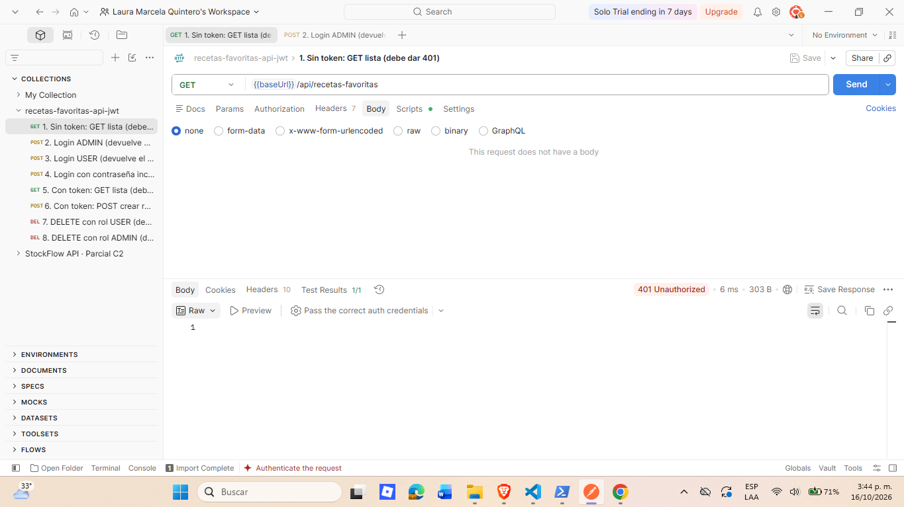
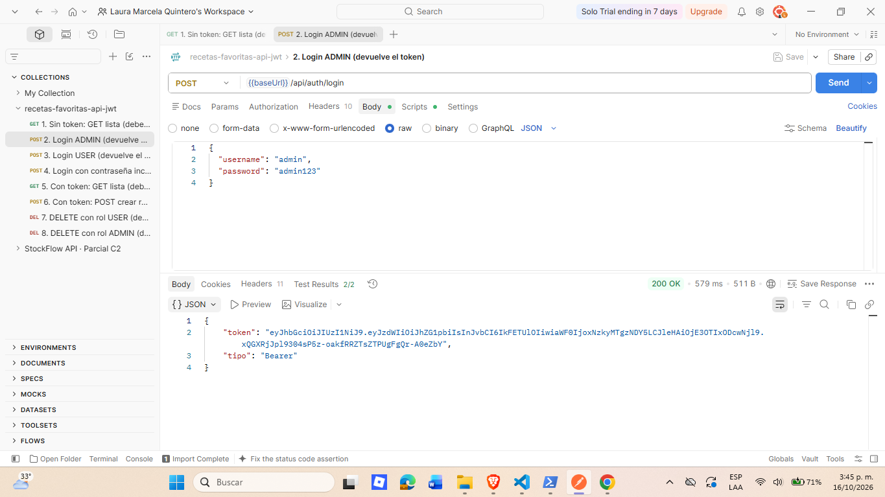
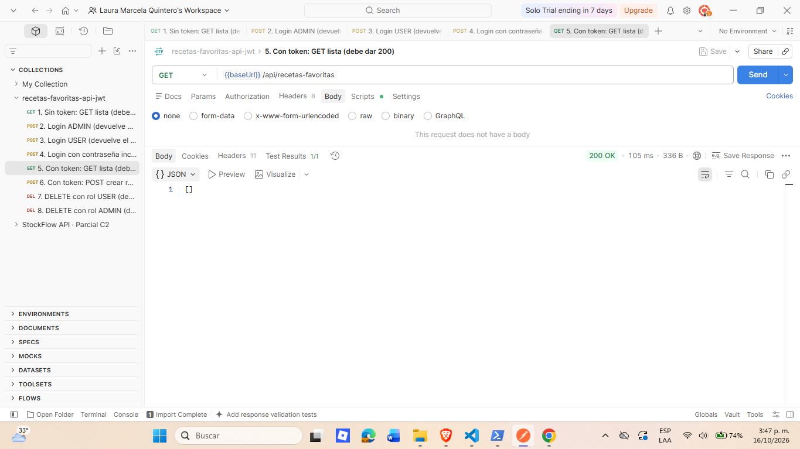
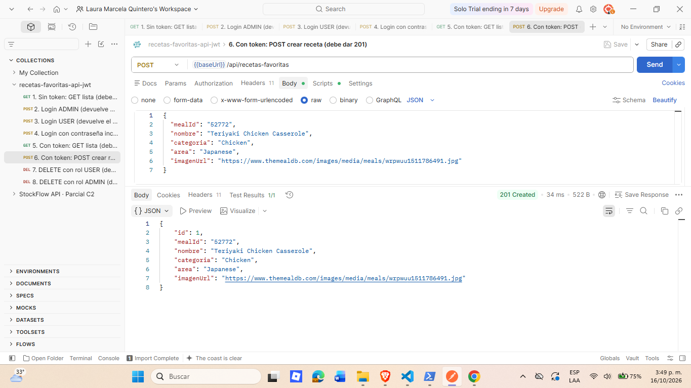
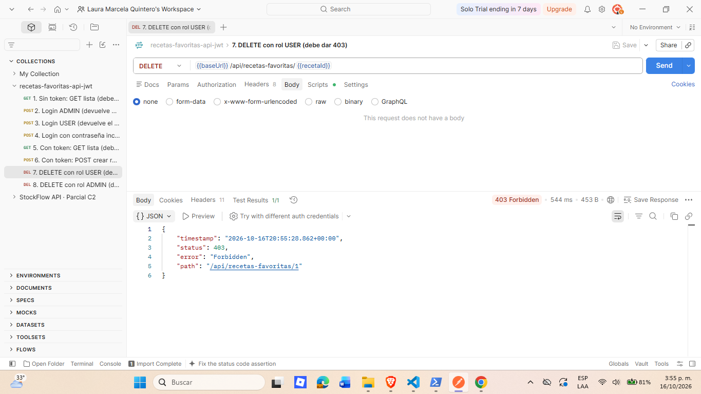
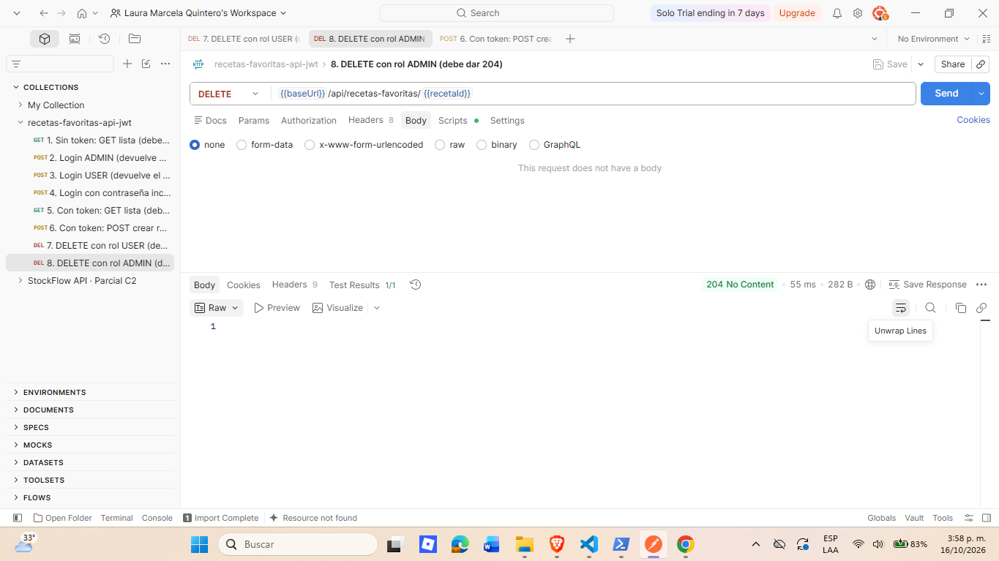

# Semana 11 · Seguridad con JWT — Recetas Favoritas

| | |
|---|---|
| **Estudiante** | Laura Marcela |
| **Materia** | Complementaria III - Profundización Desarrollo Fullstack (2026-B) |
| **Usuario de GitHub** | laura-marcela05 |

Esta semana tomé la API de Recetas Favoritas de la semana 10 y le agregué seguridad: un **login que devuelve un token JWT**
y **endpoints protegidos** que exigen ese token en la cabecera `Authorization`. Sin token, la API responde `401`; con token
válido, responde normalmente. Además agregué una regla de autorización por rol: solo un `ADMIN` puede borrar recetas.

El proyecto sigue siendo Spring Boot (Java 17, Maven) con H2 en memoria. Ahora usa también Spring Security y la librería JJWT.

## 1. Autenticación y autorización

- **Autenticación** es verificar **quién eres**: se hace con el login (usuario y contraseña).
- **Autorización** es decidir **qué puedes hacer**: se hace con el rol que va dentro del token.

Primero te autenticas, y después el sistema autoriza cada acción.

## 2. El flujo con JWT

```
1) POST /api/auth/login (username, password)  ───────►  El backend verifica la contraseña
2)            ◄───────────  devuelve un JWT (token firmado)
3) GET /api/recetas-favoritas
   Authorization: Bearer <token>  ───────────────────►  El backend valida el token
4)            ◄───────────  200 si el token es válido, 401 si falta o es inválido
```

Un JWT tiene tres partes separadas por puntos: `cabecera.contenido.firma`.

- El **contenido** (payload) lleva la identidad (`sub`), el rol (`rol`), la fecha de creación (`iat`) y la de caducidad (`exp`).
  **No lleva la contraseña.** Ojo: el contenido solo está codificado en Base64, cualquiera puede leerlo, por eso nunca se guarda
  información sensible dentro.
- La **firma** se calcula con una clave secreta que solo conoce el servidor. Si alguien cambia el contenido, la firma deja de
  coincidir y el servidor rechaza el token.
- El servidor es **stateless**: no guarda sesiones en memoria, solo valida el token en cada petición.

## 3. Qué cambió respecto a la semana 10

| Archivo | Cambio |
|---|---|
| `pom.xml` | Nuevo: Spring Security y JJWT |
| `application.properties` | Nuevo: clave y duración del token; consola de H2 desactivada |
| `model/Usuario.java` | Nuevo: entity de usuario (la contraseña se guarda como hash) |
| `repository/UsuarioRepository.java` | Nuevo: `findByUsername` |
| `dto/LoginRequest.java`, `dto/LoginResponse.java` | Nuevo: lo que entra y sale del login |
| `service/AuthService.java` | Nuevo: lógica del login (comprueba la contraseña y pide el token) |
| `controller/AuthController.java` | Nuevo: `POST /api/auth/login` |
| `security/JwtService.java` | Nuevo: crea y valida los tokens |
| `security/JwtAuthFilter.java` | Nuevo: lee el token de cada petición |
| `security/SecurityConfig.java` | Nuevo: qué rutas son públicas, cuáles exigen token y cuáles exigen rol |
| `config/DataInitializer.java` | Nuevo: crea los dos usuarios de prueba al arrancar |

Las capas de recetas (`RecetaFavorita`, su repository, service y controller) **no cambiaron**: la seguridad se agrega por fuera.
El login también respeta las capas: el controller solo recibe y responde, el service decide, y el repository consulta.

## 4. Usuarios de prueba

Como H2 está en memoria, estos usuarios se crean cada vez que arranca la aplicación:

| Usuario | Contraseña | Rol |
|---|---|---|
| `admin` | `admin123` | `ADMIN` |
| `user` | `user123` | `USER` |

Son solo para la actividad. En la base de datos las contraseñas se guardan cifradas con BCrypt, nunca en texto plano.

## 5. Qué está protegido

| Ruta | Quién puede entrar |
|---|---|
| `POST /api/auth/login` | Cualquiera (es pública) |
| `/swagger-ui.html`, `/v3/api-docs` | Cualquiera (es pública) |
| `GET`, `POST`, `PUT /api/recetas-favoritas/**` | Cualquier usuario con token válido |
| `DELETE /api/recetas-favoritas/{id}` | Solo con token de rol `ADMIN` |

Códigos que devuelve la seguridad:

| Situación | Código |
|---|---|
| No se envía token, o el token es falso o venció | `401 Unauthorized` |
| Token válido, pero el rol no tiene permiso | `403 Forbidden` |
| Usuario o contraseña incorrectos en el login | `401 Unauthorized` |

La diferencia entre `401` y `403` es justo la de autenticación y autorización: `401` es "no sé quién eres" y `403` es
"sé quién eres, pero no puedes hacer esto".

## 6. Cómo ejecutarla

Se necesita Java 17 o superior y Maven. Desde la carpeta `recetas-favoritas-api`:

```bash
mvn spring-boot:run
```

La API queda en `http://localhost:8080`. Es normal que la consola muestre una línea
`Using generated security password`: es una contraseña que Spring genera por defecto y esta API **no la usa**, porque
la autenticación se hace con el token.

## 7. Pruebas con Postman

Las peticiones están en `postman/recetas-favoritas-jwt.postman_collection.json` (se importa en Postman y se ejecuta en orden).
El login guarda el token en una variable de la colección, y las siguientes peticiones lo envían con
`Authorization: Bearer {{token}}`.

| # | Petición | Resultado esperado |
|---|---|---|
| 1 | `GET /api/recetas-favoritas` **sin token** | `401 Unauthorized` |
| 2 | `POST /api/auth/login` con `admin` | `200 OK` y el token |
| 3 | `POST /api/auth/login` con `user` | `200 OK` y el token |
| 4 | `POST /api/auth/login` con contraseña incorrecta | `401 Unauthorized` |
| 5 | `GET /api/recetas-favoritas` **con token** | `200 OK` |
| 6 | `POST /api/recetas-favoritas` con token | `201 Created` |
| 7 | `DELETE /api/recetas-favoritas/{id}` con token de `USER` | `403 Forbidden` |
| 8 | `DELETE /api/recetas-favoritas/{id}` con token de `ADMIN` | `204 No Content` |

**Sin token → 401**



**Login → 200 y token**



**Con token → 200**



**Crear con token → 201**



**Autorización por rol: USER no puede borrar → 403**



**Autorización por rol: ADMIN sí puede borrar → 204**



## 8. Cosas que aprendí

- Sin la línea del `authenticationEntryPoint`, Spring Security responde `403` cuando falta el token, no `401`. Hay que
  configurarlo para que diga `401`.
- La clave que firma los tokens no debe estar escrita en el código de un proyecto real. Aquí está en `application.properties`
  solo por la actividad, pero ya queda preparada para leerse de una variable de entorno (`JWT_SECRET`).
- El token dura 1 hora. Después de eso hay que volver a iniciar sesión.

## 9. Estructura del proyecto

```
11-week/
└── recetas-favoritas-api/
    ├── pom.xml
    ├── evidencias/                                  (capturas de Postman)
    ├── postman/
    │   └── recetas-favoritas-jwt.postman_collection.json
    └── src/main/
        ├── java/com/corhuila/recetasfavoritas/
        │   ├── RecetasFavoritasApplication.java
        │   ├── config/DataInitializer.java
        │   ├── controller/AuthController.java
        │   ├── controller/RecetaFavoritaController.java
        │   ├── dto/LoginRequest.java
        │   ├── dto/LoginResponse.java
        │   ├── model/RecetaFavorita.java
        │   ├── model/Usuario.java
        │   ├── repository/RecetaFavoritaRepository.java
        │   ├── repository/UsuarioRepository.java
        │   ├── security/JwtAuthFilter.java
        │   ├── security/JwtService.java
        │   ├── security/SecurityConfig.java
        │   ├── service/AuthService.java
        │   └── service/RecetaFavoritaService.java
        └── resources/application.properties
```
