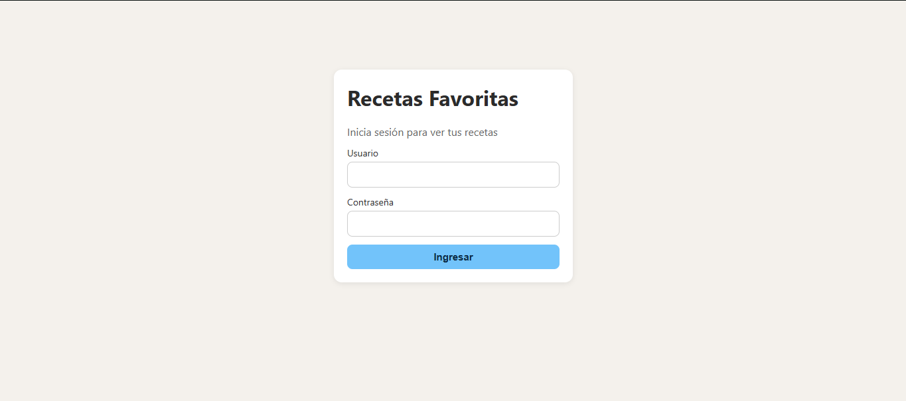
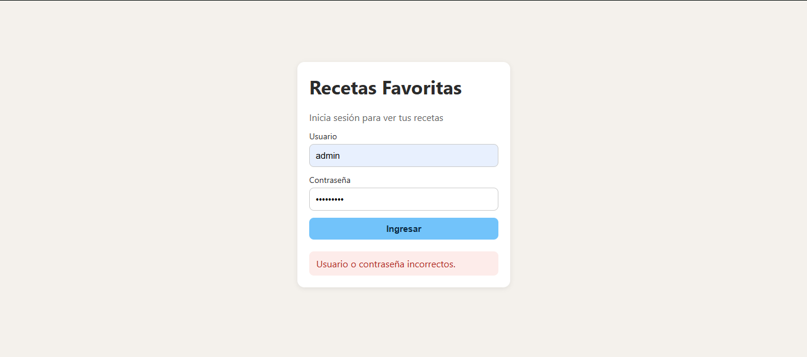
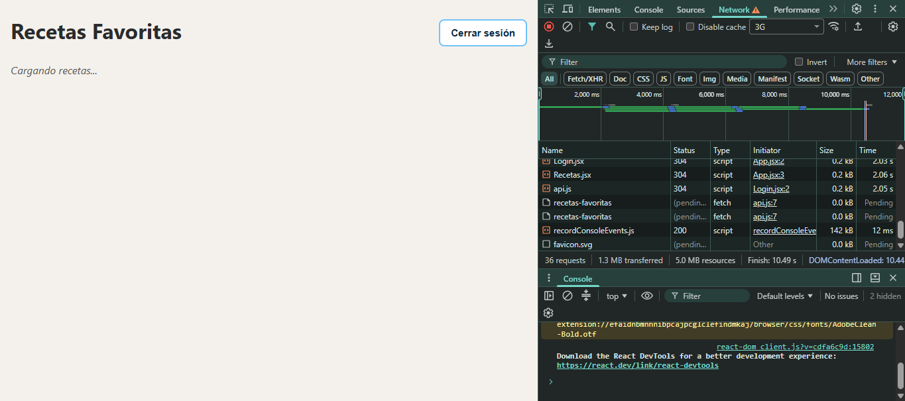
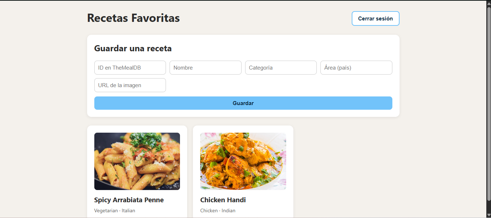
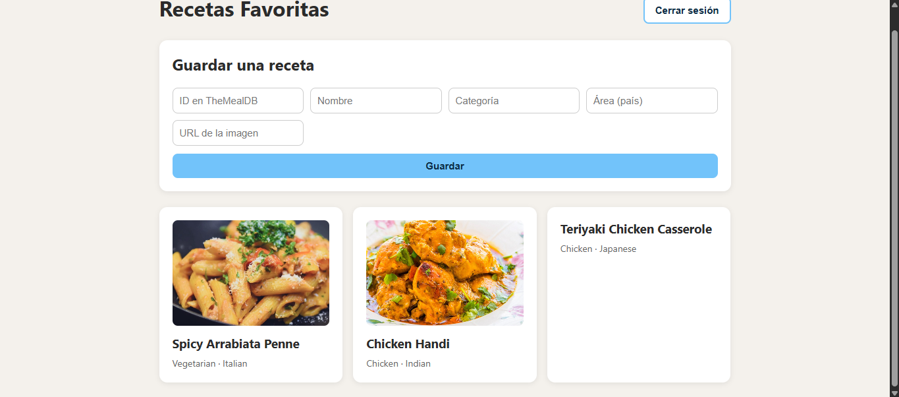
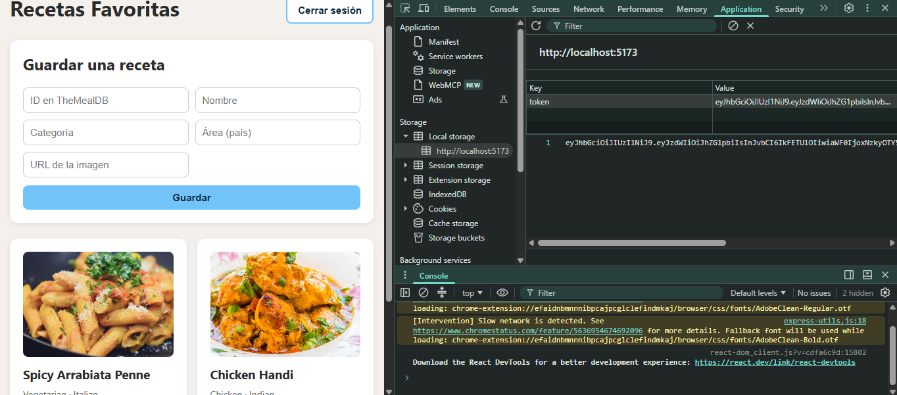
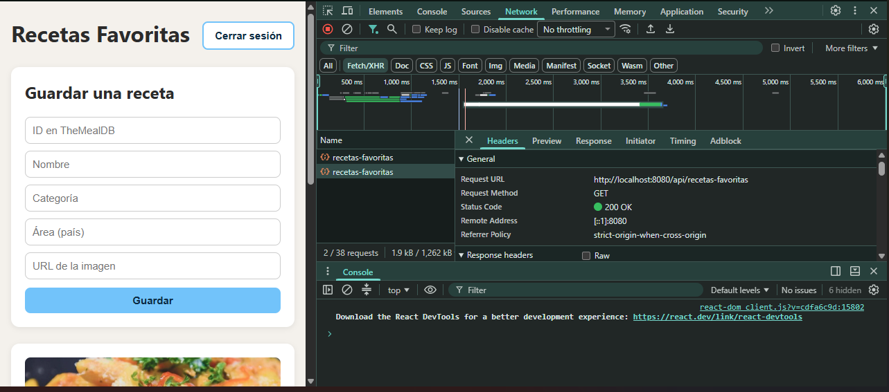
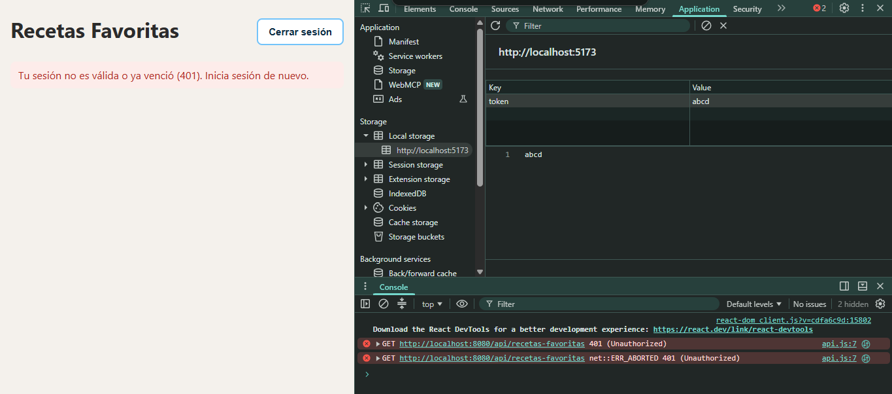
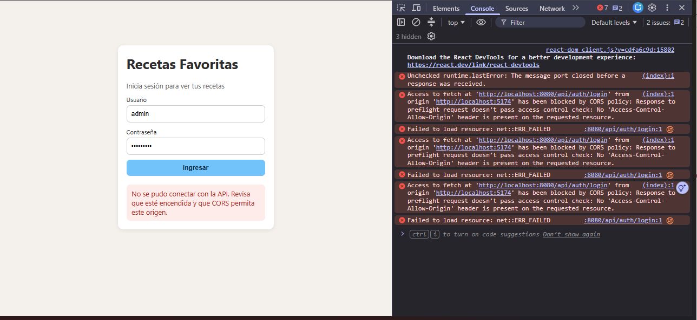

# Semana 12 · Integrar frontend y backend — Recetas Favoritas

| | |
|---|---|
| **Estudiante** | Laura Marcela |
| **Materia** | Complementaria III - Profundización Desarrollo Fullstack (2026-B) |
| **Usuario de GitHub** | laura-marcela05 |

Hasta la semana pasada mi API de recetas favoritas ya pedía login y token, pero solo la probaba desde Postman. Esta semana
le hice un frontend en React que la usa de verdad: inicio sesión desde una pantalla de login, guardo el token que devuelve
la API y con ese token pido las recetas protegidas y las muestro como tarjetas. También se pueden guardar recetas nuevas.
Mientras llegan los datos se ve un mensaje de carga y, si algo falla, un mensaje de error en lugar de una pantalla en blanco.

Para que el navegador dejara al frontend (`localhost:5173`) hablar con la API (`localhost:8080`) tuve que habilitar CORS
en el backend.

```
[ React (localhost:5173) ] ──POST /api/auth/login──►  [ API Spring Boot (localhost:8080) ] ──► [ H2 ]
        │  guarda el token en localStorage
        └──GET /api/recetas-favoritas (Authorization: Bearer <token>)──►  responde JSON ──► tarjetas
```

## 1. Estructura del proyecto

```
02-optional-activity/
├── README.md
├── evidencias/                                  (capturas de las pruebas de esta semana)
├── recetas-favoritas-api/                       (backend, el mismo de la semana 11)
│   ├── pom.xml
│   └── src/main/
│       ├── java/com/corhuila/recetasfavoritas/
│       │   ├── config/DataInitializer.java      (cambió: carga dos recetas al arrancar)
│       │   ├── controller/
│       │   │   ├── RecetaFavoritaController.java (cambió: @CrossOrigin)
│       │   │   └── AuthController.java          (cambió: @CrossOrigin)
│       │   ├── security/SecurityConfig.java     (cambió: activa CORS en la seguridad)
│       │   └── ...                              (el resto no cambió)
│       └── resources/application.properties
└── recetas-favoritas-front/                     (nuevo: frontend en React con Vite)
    ├── package.json
    ├── vite.config.js
    ├── index.html
    └── src/
        ├── main.jsx                             (arranca React)
        ├── App.jsx                              (decide si mostrar el login o las recetas)
        ├── App.css                              (estilos)
        ├── api.js                               (todas las llamadas a la API)
        └── components/
            ├── Login.jsx                        (formulario de login)
            └── Recetas.jsx                      (listado, estados y formulario para guardar)
```

En el backend no cambié la entidad, las capas ni los endpoints; solo agregué CORS y unos datos iniciales. En el frontend
separé las llamadas a la API (`api.js`) de los componentes que pintan la pantalla, y los estilos van en su propio archivo.

## 2. Cambios en el backend

### CORS

CORS es una protección del navegador: si una página que está en un origen (`http://localhost:5173`) intenta llamar a una
API en otro (`http://localhost:8080`), el navegador bloquea la respuesta a menos que la API diga que ese origen está
permitido. Postman no es un navegador, por eso la semana pasada nunca apareció este problema.

Le agregué `@CrossOrigin` a los dos controladores, porque el frontend usa los dos: el de login y el de recetas.

```java
@CrossOrigin(origins = "http://localhost:5173")
@RestController
@RequestMapping("/api/recetas-favoritas")
public class RecetaFavoritaController { /* ... */ }
```

Con Spring Security eso solo no basta. Cuando el navegador va a enviar una petición con la cabecera `Authorization`,
primero manda una petición previa de tipo `OPTIONS` (el *preflight*) para preguntar si está permitido, y esa petición
nunca lleva el token. Sin más, la seguridad la rechazaba con `401` y el navegador cancelaba la petición real. Por eso en
`SecurityConfig` activé CORS dentro de la cadena de seguridad; así Spring Security lee los `@CrossOrigin` de los
controladores y responde ese preflight antes de exigir el token:

```java
http
    .cors(Customizer.withDefaults())
    .csrf(AbstractHttpConfigurer::disable)
    // ... lo demás quedó igual que la semana 11
```

Solo permití `http://localhost:5173`, que es donde corre el frontend; desde cualquier otro origen el navegador sigue
bloqueando las peticiones.

### Datos iniciales

H2 es una base de datos en memoria y arranca vacía cada vez. Para que el frontend tenga algo que mostrar apenas inicio
sesión, en `DataInitializer` (que ya creaba los usuarios de prueba) también cargo dos recetas al arrancar la aplicación:

```java
recetaRepository.save(new RecetaFavorita("52771", "Spicy Arrabiata Penne", "Vegetarian", "Italian", "https://..."));
recetaRepository.save(new RecetaFavorita("52795", "Chicken Handi", "Chicken", "Indian", "https://..."));
```

## 3. El frontend

Lo hice con React y Vite. En `vite.config.js` dejé fijo el puerto 5173 con `strictPort`, porque es justo el origen que la
API tiene permitido en CORS; si el puerto estuviera ocupado, Vite falla en vez de cambiarse a otro y quedar bloqueado.

```js
server: { port: 5173, strictPort: true }
```

### Las llamadas a la API (`api.js`)

Puse la dirección del backend en una sola constante, así no queda repetida por todo el proyecto:

```js
const API_URL = "http://localhost:8080/api";
```

`login` envía el usuario y la contraseña y, si son correctos, guarda el token en `localStorage` para no perderlo al
recargar la página:

```js
export async function login(username, password) {
  const res = await pedir(`${API_URL}/auth/login`, {
    method: "POST",
    headers: { "Content-Type": "application/json" },
    body: JSON.stringify({ username, password }),
  });
  if (res.status === 401) throw new Error("Usuario o contraseña incorrectos.");
  if (!res.ok) throw new Error("Error " + res.status);

  const datos = await res.json();
  localStorage.setItem("token", datos.token);
  return datos.token;
}
```

`conToken` lee el token guardado y lo envía en la cabecera `Authorization: Bearer <token>`, que es lo que revisa el filtro
JWT de la API. Con ella se hacen `getRecetas` (GET) y `crearReceta` (POST). Si la API responde `401` es porque el token no
es válido o ya venció, y si responde `403` es porque el rol no tiene permiso:

```js
async function conToken(ruta, opciones = {}) {
  const token = localStorage.getItem("token");
  const res = await pedir(`${API_URL}${ruta}`, {
    ...opciones,
    headers: { ...opciones.headers, Authorization: `Bearer ${token}` },
  });
  if (res.status === 401) throw new Error("Tu sesión no es válida o ya venció (401). Inicia sesión de nuevo.");
  if (res.status === 403) throw new Error("No tienes permiso para hacer esto (403).");
  if (!res.ok) throw new Error("Error " + res.status);
  return res;
}
```

Todas usan `pedir`, que envuelve a `fetch`. `fetch` solo falla por su cuenta cuando no llega ninguna respuesta, que es lo
que pasa si la API está apagada o si el navegador la bloquea por CORS; en ese caso muestro un mensaje claro en vez del
"Failed to fetch" del navegador.

### Login (`Login.jsx`) y cambio de pantalla (`App.jsx`)

El formulario llama a `login`. Mientras espera, el botón se desactiva y dice "Ingresando..."; si falla, aparece el mensaje
de error debajo.

`App.jsx` guarda el token en el estado: si hay token muestra las recetas y si no, el login. Al abrir la página lo toma de
`localStorage`, así que si ya había iniciado sesión entro directo. El botón "Cerrar sesión" borra el token y vuelve al
login.

```jsx
const [token, setToken] = useState(localStorage.getItem("token"));
// ...
{token ? <Recetas onCerrarSesion={cerrarSesion} /> : <Login onLogin={setToken} />}
```

### Recetas con estados de carga y error (`Recetas.jsx`)

Cuando aparece la pantalla, `useEffect` pide las recetas. La variable `estado` dice qué se muestra: `"cargando"` mientras
llega la respuesta, las tarjetas cuando llegan los datos y el mensaje de error si algo falla. Así la pantalla nunca queda
en blanco.

```jsx
const [estado, setEstado] = useState("cargando"); // "cargando" | "ok" | "error"

useEffect(() => {
  getRecetas()
    .then((datos) => { setRecetas(datos); setEstado("ok"); })
    .catch((err) => { setError(err.message); setEstado("error"); });
}, []);
```

Además hay un formulario para guardar una receta nueva (`POST /api/recetas-favoritas` con el token); al guardarse, la
tarjeta aparece en el listado sin recargar la página.

## 4. Cómo ejecutarlo

Se necesitan Java 17 o superior, Maven y Node.js (versión 20.19 o superior). Hay que levantar los dos proyectos, cada uno
en su propia terminal.

Backend, desde la carpeta `recetas-favoritas-api`:

```bash
mvn spring-boot:run
```

Frontend, desde la carpeta `recetas-favoritas-front` (el `npm install` solo hace falta la primera vez):

```bash
npm install
npm run dev
```

Luego se abre `http://localhost:5173` en el navegador y se inicia sesión con el usuario `admin` y la contraseña
`admin123` (o `user` / `user123`).

## 5. Pruebas

Probé el recorrido completo en el navegador, con las herramientas de desarrollador abiertas para ver el token y las
peticiones.

1. **Pantalla de login** — Al abrir `http://localhost:5173` sin haber iniciado sesión aparece el formulario.

   

2. **Contraseña incorrecta** — Con `admin` y una contraseña equivocada la API responde `401` y la pantalla muestra
   "Usuario o contraseña incorrectos." sin dejarme entrar.

   

3. **Cargando** — Con `admin` / `admin123` entro al listado. Simulé una red lenta en el navegador (Slow 3G) para que se
   alcanzara a ver el mensaje "Cargando recetas..." mientras llega la respuesta.

   

4. **Datos del listado** — Cuando responde la API se muestran las tarjetas con las recetas.

   

5. **Crear una receta** — Con el formulario guardé una receta nueva (Teriyaki Chicken Casserole) y apareció en el listado.

   

6. **Token guardado** — En Application → Local Storage de `http://localhost:5173` queda guardado el token que devolvió el
   login.

   

7. **Petición con token y CORS** — En la pestaña Network, la petición `GET /api/recetas-favoritas` responde `200` y lleva
   la cabecera `Authorization: Bearer ...`. En la respuesta viene `Access-Control-Allow-Origin: http://localhost:5173`,
   que es lo que le dice al navegador que este frontend tiene permiso.

   

8. **Token inválido** — Cambié a mano el token de `localStorage` por `abc` y recargué. La API responde `401` y la pantalla
   muestra el mensaje de sesión no válida en lugar de quedarse en blanco; con "Cerrar sesión" vuelvo al login.

   

9. **Origen no permitido** — Para comprobar que CORS sí está filtrando, levanté el mismo frontend en el puerto 5174
   (`npm run dev -- --port 5174`). Al intentar iniciar sesión, el navegador bloquea la petición (se ve el error de CORS en
   la consola) y la pantalla muestra "No se pudo conectar con la API". Desde 5173, que es el origen permitido, todo
   funciona.

   

## 6. Qué cubre cada criterio de la rúbrica

| Criterio | Dónde se ve |
|---|---|
| Login + token | `api.js` (`login`), pruebas 1, 2 y 6 |
| Consumo protegido | `api.js` (`conToken`, `getRecetas`, `crearReceta`), pruebas 4, 5 y 7 |
| CORS + estados | `@CrossOrigin` y `SecurityConfig` en el backend, `estado` en `Recetas.jsx`, pruebas 3, 7, 8 y 9 |

## 7. Cosas que aprendí

- CORS lo aplica el navegador, no la API: por eso Postman nunca lo mostró y el frontend sí.
- Con Spring Security hay que activar `.cors(...)` en la cadena de seguridad; si no, el preflight `OPTIONS` (que no lleva
  token) recibe `401` y la petición real nunca sale.
- El token se guarda en `localStorage` y se envía en cada petición en la cabecera `Authorization`. Si falta, está dañado
  o venció, la API responde `401`, y el frontend debe mostrarlo en vez de dejar la pantalla en blanco.
- Conviene dejar la URL del backend en un solo lugar (`api.js`) y fijar el puerto del frontend para que coincida con el
  origen permitido en CORS.