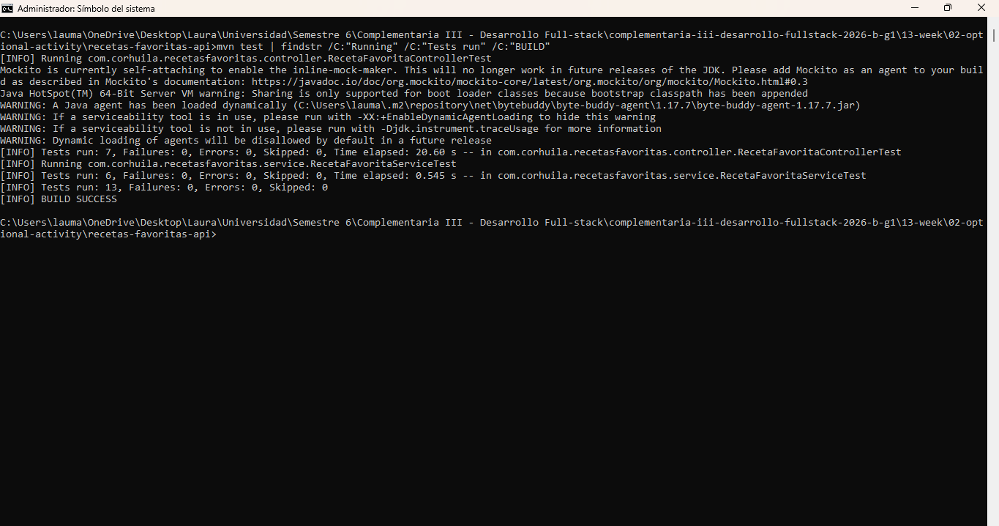
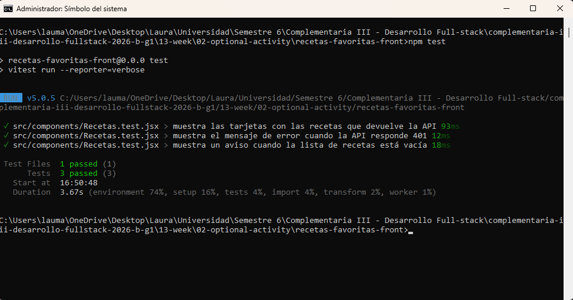

# Semana 13 · Pruebas de la aplicación — Recetas Favoritas

| | |
|---|---|
| **Estudiante** | Laura Marcela |
| **Materia** | Complementaria III - Profundización Desarrollo Fullstack (2026-B) |
| **Usuario de GitHub** | laura-marcela05 |

Hasta la semana pasada todo lo que comprobaba de mi proyecto de recetas favoritas lo hacía a mano: peticiones en Postman y
clics en el navegador. Esta semana le escribí pruebas automáticas al backend y al frontend, para que con un solo comando
se revise que todo sigue funcionando y que nada se rompa en silencio cuando cambie algo.

- **Backend:** una prueba unitaria del service (solo esa clase, aislada) y una prueba de integración de los endpoints
  (la petición pasa por la seguridad JWT, el controller, el service, el repository y H2).
- **Frontend:** una prueba del componente `Recetas`, que es el que muestra las recetas guardadas.
- En las dos partes pruebo también lo que pasa cuando algo sale mal: ids que no existen, peticiones sin token o con token
  falso, un usuario sin permiso para borrar, un error 401 en la pantalla y una lista vacía.

## 1. Estructura del proyecto

```
02-optional-activity/
├── README.md
├── evidencias/                                   (capturas de las pruebas)
├── recetas-favoritas-api/                        (backend, el mismo de la semana 12)
│   ├── pom.xml                                   (cambió: dependencia de pruebas)
│   └── src/
│       ├── main/                                 (sin cambios)
│       └── test/java/com/corhuila/recetasfavoritas/   (nuevo)
│           ├── service/                          (prueba unitaria del service)
│           └── controller/RecetaFavoritaControllerTest.java  (prueba de integración)
└── recetas-favoritas-front/                      (frontend, el mismo de la semana 12)
    ├── package.json                              (cambió: script "test" y librerías de pruebas)
    ├── vite.config.js                            (cambió: configuración de las pruebas)
    └── src/
        ├── setupTests.js                         (nuevo)
        └── components/
            ├── Recetas.jsx
            └── Recetas.test.jsx                  (nuevo: prueba del componente)
```

No toqué el código de la aplicación: la entidad, las capas, los endpoints y los componentes son los mismos de la semana
pasada. Solo agregué las pruebas y lo necesario para ejecutarlas. Las pruebas van en `src/test`, separadas de `src/main`,
y Maven no las incluye en la aplicación que se ejecuta.

## 2. Pruebas del backend

En el `pom.xml` agregué `spring-boot-starter-test` con `scope` test, o sea que solo se usa al ejecutar las pruebas. Trae
JUnit 5 (las pruebas y los `assert...`), Mockito (objetos falsos) y MockMvc (peticiones a los endpoints sin abrir el
puerto 8080).

```xml
<dependency>
    <groupId>org.springframework.boot</groupId>
    <artifactId>spring-boot-starter-test</artifactId>
    <scope>test</scope>
</dependency>
```

Los nombres de las pruebas siguen el patrón `metodo_situacion_resultado`, para que se entienda qué hace cada una y qué
espera.

### Prueba unitaria del service

Pruebo solo `RecetaFavoritaService`. El repositorio lo reemplazo por un mock de Mockito (un repositorio falso al que le
digo qué responder), así que no hay base de datos ni Spring y la prueba es muy rápida. Son 6 pruebas:

- **Caminos felices:** actualizar una receta que existe (queda con el id indicado y se llama a `save`), borrar una receta
  que existe (se llama a `deleteById` y devuelve `true`) y filtrar por categoría (devuelve lo que entrega el repositorio).
- **Casos de error:** actualizar o borrar un id que no existe. En esos casos el service devuelve vacío o `false`, que el
  controller convierte en 404, y se verifica que nunca se llame a `save` ni a `deleteById`.

### Prueba de integración de los endpoints (`RecetaFavoritaControllerTest`)

Aquí no hay nada falso. `@SpringBootTest` levanta la aplicación completa, con la seguridad JWT y la base H2, y `MockMvc`
hace las peticiones HTTP como si fuera Postman. Antes de cada prueba hago un login real con `admin / admin123` y con
`user / user123` para obtener un token de cada rol. La clase usa `@Transactional`, que deshace al terminar cada prueba lo
que se haya guardado, para que no se afecten entre sí. Son 7 pruebas:

| Prueba | Tipo | Resultado esperado |
|---|---|---|
| `listar_conToken_responde200ConLasDosRecetasIniciales` | camino feliz | 200 con las dos recetas que carga `DataInitializer` |
| `crear_conToken_responde201YDevuelveLaRecetaConId` | camino feliz | 201 y la receta con su id |
| `listar_sinToken_responde401` | error | 401 |
| `listar_conTokenFalso_responde401` | error | 401 |
| `buscar_idInexistente_responde404` | error | 404 |
| `borrar_comoUsuarioNormal_responde403` | error | 403, porque borrar es solo para ADMIN |
| `borrar_comoAdminConIdInexistente_responde404` | error | 404 |

La diferencia entre las dos clases es justo la diferencia entre unitaria e integración: la primera prueba una sola pieza
con todo lo demás simulado, y la segunda prueba que todas las capas funcionen juntas.

## 3. Prueba del frontend

Usé **Vitest**, que funciona con la misma configuración de Vite que ya tenía, junto con **React Testing Library**, que
dibuja el componente y permite buscar textos en la pantalla como lo haría un usuario. Las librerías que agregué en
`package.json` (todas como dependencias de desarrollo) son:

- `vitest`: ejecuta las pruebas.
- `jsdom`: simula el navegador dentro de Node, porque las pruebas no abren un navegador de verdad.
- `@testing-library/react` y `@testing-library/dom`: dibujan el componente y buscan elementos en la pantalla.
- `@testing-library/jest-dom`: agrega comprobaciones como `toBeInTheDocument()`.

También agregué el script `"test": "vitest run --reporter=verbose"`, que ejecuta las pruebas una vez y muestra el nombre
de cada una con su resultado. En `vite.config.js` le indiqué a Vitest que use `jsdom` y que cargue `setupTests.js` antes
de las pruebas:

```js
test: {
  environment: 'jsdom',
  globals: true,
  setupFiles: './src/setupTests.js',
},
```

### Prueba del componente `Recetas` (`Recetas.test.jsx`)

El componente pide los datos con `getRecetas` de `api.js`. En la prueba reemplazo `api.js` por una versión falsa con
`vi.mock("../api")`, así no necesito el backend encendido y en cada caso decido qué responde la API. Si la prueba
dependiera de la API real, fallaría cada vez que el backend estuviera apagado o cambiaran los datos. Son 3 pruebas:

| Prueba | Tipo | Qué comprueba |
|---|---|---|
| `muestra las tarjetas con las recetas que devuelve la API` | camino feliz | Primero se ve "Cargando recetas..." y luego las dos recetas. |
| `muestra el mensaje de error cuando la API responde 401` | error | Aparece el mensaje de sesión no válida y no se muestra el formulario. |
| `muestra un aviso cuando la lista de recetas está vacía` | límite | Aparece "Aún no tienes recetas favoritas." en lugar de una pantalla vacía. |

Para esperar los datos uso `findByText`, que espera a que el texto aparezca, porque la respuesta llega después de dibujar
el componente.

## 4. Cómo ejecutar las pruebas

Se necesitan Java 17 o superior, Maven y Node.js (versión 20.19 o superior). Para las pruebas no hace falta tener la API ni
el frontend encendidos.

Backend, desde la carpeta `recetas-favoritas-api`:

```
mvn test
```

Frontend, desde la carpeta `recetas-favoritas-front` (el `npm install` solo hace falta la primera vez):

```
npm install
npm test
```

La aplicación se sigue ejecutando igual que la semana pasada (`mvn spring-boot:run` y `npm run dev`).

## 5. Resultados

1. **Pruebas del backend:** `mvn test` ejecuta 13 pruebas (6 del service y 7 de los endpoints). Todas pasan
   (`Tests run: 13, Failures: 0, Errors: 0`) y termina en `BUILD SUCCESS`.

   

2. **Pruebas del frontend:** `npm test` ejecuta las 3 pruebas del componente `Recetas`, cada una con su nombre: la del
   listado, la del error 401 y la de la lista vacía. Pasan todas (`Tests 3 passed (3)`).

   

Ahora, antes de subir un cambio, con `mvn test` y `npm test` sé en pocos segundos si mis recetas siguen funcionando,
tanto cuando todo sale bien como cuando algo falla.
