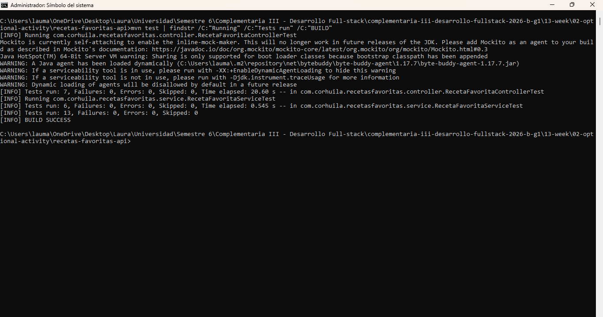
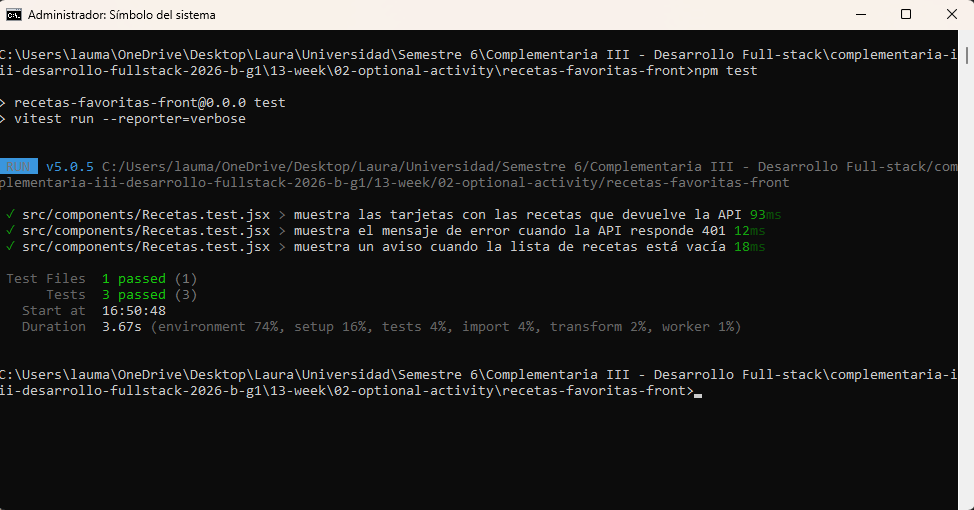
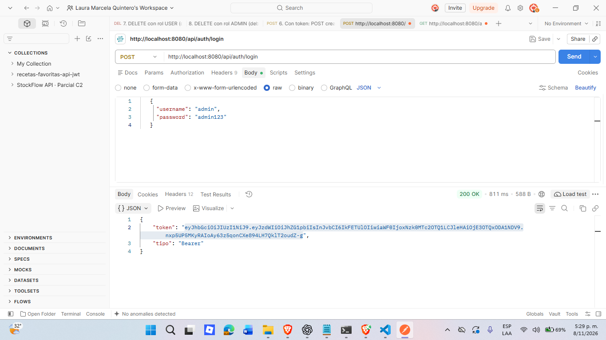
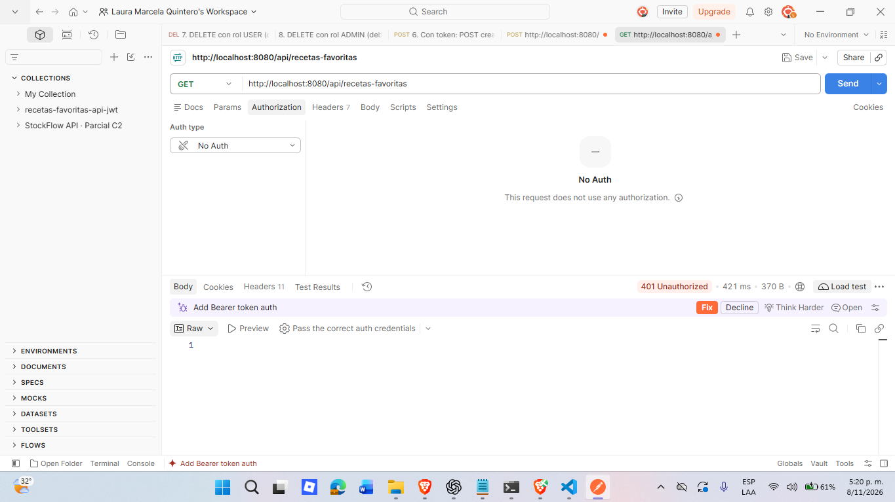
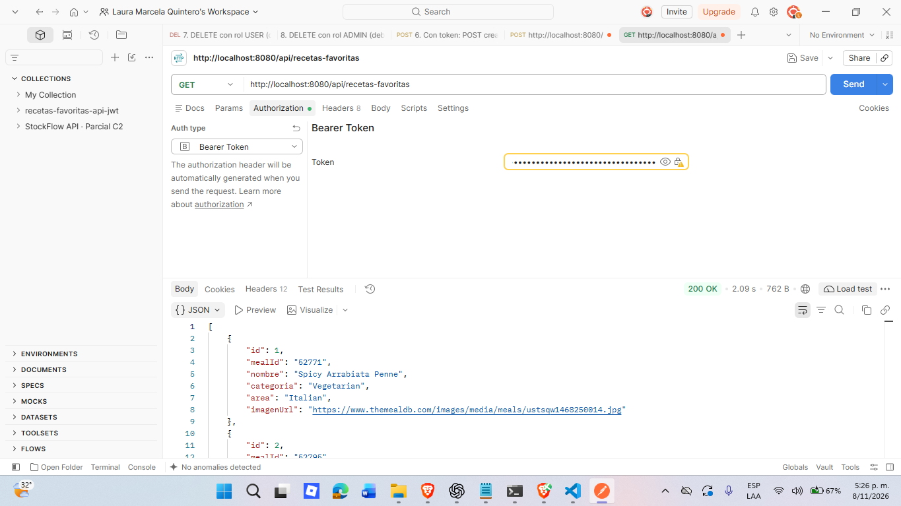
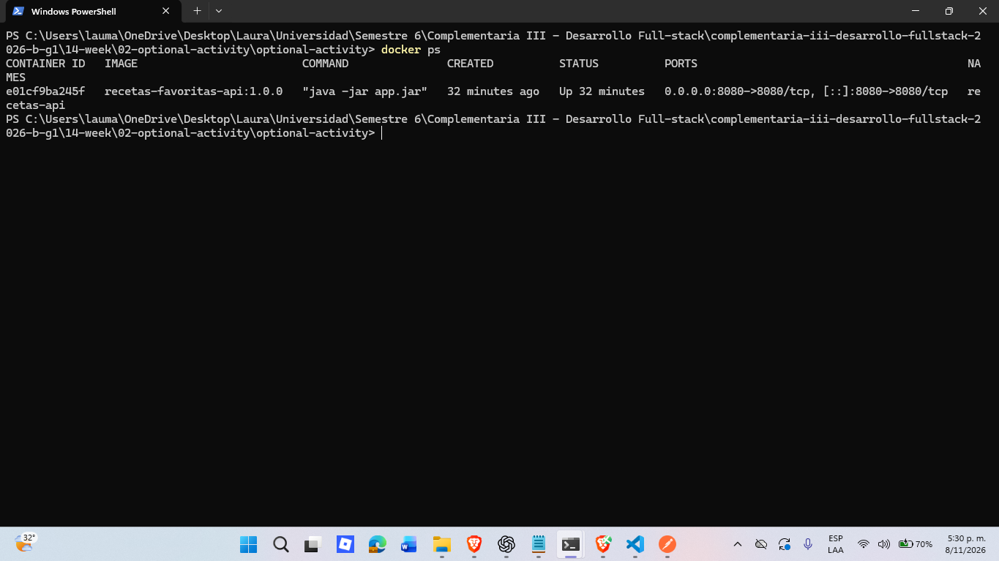
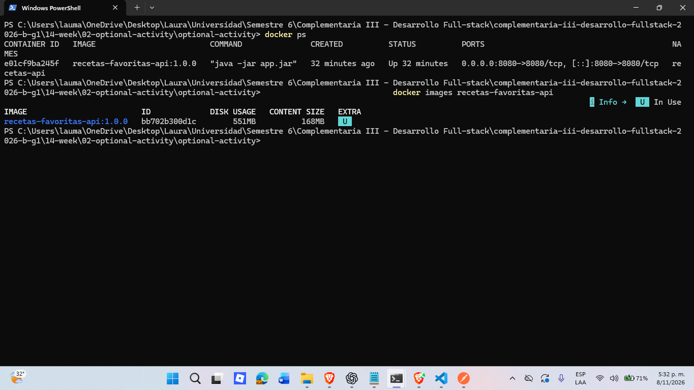
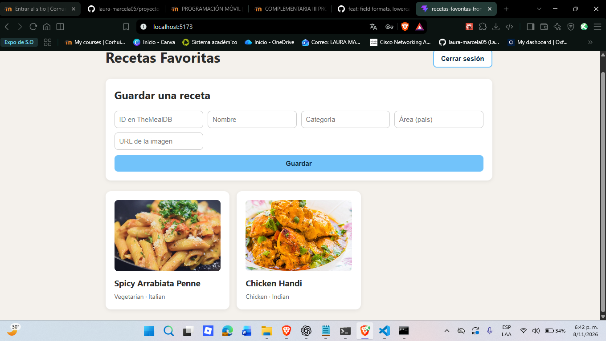
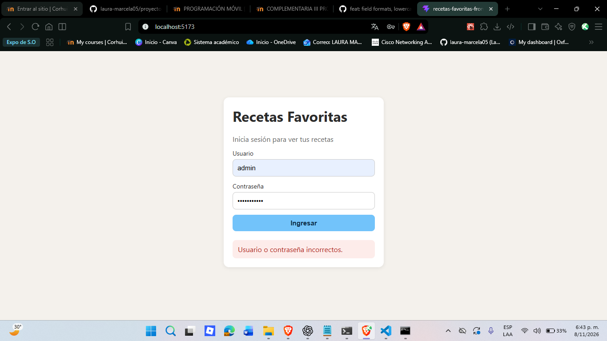
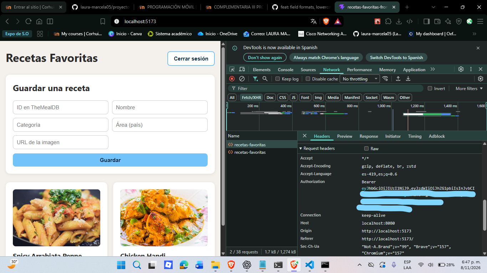

# Actividad calificable · Corte 3 — App fullstack segura y probada

| | |
|---|---|
| **Estudiante** | Laura Marcela |
| **Materia** | Complementaria III - Profundización Desarrollo Fullstack (2026-B) |
| **Usuario de GitHub** | laura-marcela05 |

App de **Recetas Favoritas**: una API REST con login JWT, un frontend en React que la consume (resolviendo CORS), pruebas
automáticas en backend y frontend, y el backend empaquetado en un contenedor Docker.

## Security & run

In this activity, I gained a better understanding of how logins and permissions work in my project. I tested `POST /api/auth/login` with two users: `admin` and `user`. Upon logging in, I received a token and sent it in the `Authorization` header using the format `Bearer <token>`. In Postman, I verified that if I don't send the token to a protected path, the server returns a `401` error. I also tested what happens when `user` tries to delete a record: the server checks their role and returns a `403` error because only `ADMIN` has permission to delete. This helped me understand that logging in and having permission to perform an action are two different things. I ran 13 backend tests and 3 frontend tests.

I also gained a better understanding of what Maven and Docker do. First, I used `mvn clean package` to generate the JAR file. Then I used `docker build` to create the image and `docker run` with `-p 8080:8080` to start the container and access the backend. In my project, H2 stores data in memory, so every time the container stops, the data is lost.

## 1. Estructura del proyecto

```
c3-activity/
├── README.md
├── .gitignore
├── evidencias/                      (capturas 01-19)
├── recetas-favoritas-api/           (backend)
│   ├── Dockerfile
│   ├── .dockerignore
│   ├── pom.xml
│   └── src/
│       ├── main/java/com/corhuila/recetasfavoritas/
│       │   ├── model/  repository/  service/  controller/  dto/
│       │   ├── security/            (JwtService, JwtAuthFilter, SecurityConfig)
│       │   └── config/              (DataInitializer)
│       └── test/                    (pruebas del backend)
└── recetas-favoritas-front/         (frontend en React)
    ├── package.json
    └── src/
        ├── api.js                   (llamadas a la API)
        └── components/              (Login, Recetas y su prueba)
```

**Tecnologías:** Java 17, Spring Boot 3.5.6, Maven, JPA + H2 en memoria, Spring Security, JJWT 0.12.6, springdoc 2.8.9.
Frontend: React 19, Vite 8, Vitest 5 y Testing Library. Contenedor: imagen base `eclipse-temurin:17-jre`.

**Arquitectura del backend:** `controller → service → repository → entity`. El controller no toca el repository y las reglas
de negocio están en el service.

## 2. Seguridad con JWT

1. El usuario envía su usuario y su clave a `POST /api/auth/login`.
2. Si son correctos, el servidor responde `200` con un token firmado con la clave `JWT_SECRET`.
3. El frontend guarda el token y lo envía en cada petición: `Authorization: Bearer <token>`.
4. El filtro `JwtAuthFilter` valida la firma y la fecha de vencimiento (1 hora) antes de dejar pasar la petición.

| Situación | Código |
|---|---|
| Login correcto | 200 |
| Usuario o clave incorrectos | 401 |
| Petición a una ruta protegida sin token, o con token inválido | 401 |
| Con token válido | 200 |
| `user` intenta borrar (solo `ADMIN` puede) | 403 |

Usuarios de prueba (se crean al arrancar, solo para la actividad): `admin` / `admin123` y `user` / `user123`.

## 3. CORS

El frontend corre en `http://localhost:5173` y la API en `http://localhost:8080`. Son orígenes distintos, así que el
navegador bloquea la respuesta si el servidor no lo permite. Lo resolví con `@CrossOrigin(origins = "http://localhost:5173")`
en los dos controllers. Postman no se ve afectado, porque CORS solo lo aplican los navegadores.

## 4. Pruebas

| Dónde | Qué | Cantidad |
|---|---|---|
| Backend | Prueba unitaria del service (aislada) | 6 |
| Backend | Prueba de integración de los endpoints (pasa por seguridad JWT, controller, service, repository y H2) | 7 |
| Frontend | Prueba del componente `Recetas` (listado, error 401 y lista vacía) | 3 |

Incluyen casos de error: ids que no existen, peticiones sin token o con token falso, un usuario sin permiso para borrar,
un error 401 en pantalla y una lista vacía.

```powershell
# Backend, desde recetas-favoritas-api
mvn test

# Frontend, desde recetas-favoritas-front
npm install
npm test
```

## 5. Docker

```dockerfile
FROM eclipse-temurin:17-jre
WORKDIR /app
COPY target/recetas-favoritas-api-1.0.0.jar app.jar
EXPOSE 8080
ENTRYPOINT ["java", "-jar", "app.jar"]
```

- La imagen base es Java 17 porque el `pom.xml` compila con 17, y usa `jre` porque para ejecutar no hace falta compilar.
- El jar se construye en mi máquina con Maven y el Dockerfile solo lo copia. La otra opción, multi-stage, compila dentro de
  Docker, pero es más larga y no era necesaria.
- `EXPOSE` solo documenta el puerto. Quien lo publica hacia mi PC es `-p` en `docker run`.
- El `.dockerignore` deja fuera `src` y archivos del editor, pero **no** `target/`, porque de ahí se copia el jar.

## 6. Cómo ejecutar todo (PowerShell)

Requisitos: Docker Desktop encendido, Java 17 o superior, Maven y Node.

**Backend en contenedor**, desde `recetas-favoritas-api`:

```powershell
mvn clean package
docker build -t recetas-favoritas-api:1.0.0 .
docker run -d --name recetas-api -p 8080:8080 -e JWT_SECRET="clave-de-ejemplo-para-docker-minimo-32-caracteres" recetas-favoritas-api:1.0.0
docker ps
docker logs recetas-api --tail 15
```

**Frontend**, desde `recetas-favoritas-front`, y se abre `http://localhost:5173`:

```powershell
npm install
npm run dev
```

**Detener y borrar el contenedor** (necesario antes de crear otro con el mismo nombre):

```powershell
docker stop recetas-api
docker rm recetas-api
```

| Qué | Valor |
|---|---|
| Puerto de la API | 8080 (`-p 8080:8080`) |
| Puerto del frontend | 5173 |
| `JWT_SECRET` | Clave para firmar y validar tokens (mínimo 32 caracteres). La del ejemplo no es una clave real |

## 7. Qué se pierde al reiniciar

La base de datos es H2 en memoria (`ddl-auto=create-drop`), así que los datos viven solo mientras el contenedor corre. Al
arrancar de nuevo, `DataInitializer` vuelve a crear los usuarios `admin` y `user` y 2 recetas.

## 8. Evidencias

**Frontend y JWT**

| Captura | Qué muestra |
|---|---|
| `01-login.png` | Pantalla de login |
| `02-clave-incorrecta.png` | Error con clave incorrecta |
| `04-listado.png` | Listado de recetas tras iniciar sesión |
| `06-token-localstorage.png` | Token guardado en el navegador |
| `07-peticion-con-token-cors.png` | Petición con token y CORS permitido |
| `08-token-invalido-401.png` | Token inválido, error 401 |
| `09-cors-bloqueado.png` | Bloqueo de CORS cuando el origen no está permitido |

**Pruebas**





**API en el contenedor (Postman)**







**Contenedor e imagen**





**Frontend contra la API en el contenedor**







## 9. Errores que me pueden pasar

- **`port is already allocated`:** algo más usa el 8080 (por ejemplo `mvn spring-boot:run`). Lo cierro y repito.
- **`container name is already in use`:** ya existe un contenedor `recetas-api`. Lo borro con `docker rm recetas-api`.
- **`COPY failed: file not found`:** falta el jar. Hay que correr `mvn clean package` antes del `docker build`.
- **El contenedor se cae al arrancar:** veo la causa con `docker logs recetas-api`.
- **`npm run dev` dice que no encuentra un módulo:** `node_modules` quedó dañado. Se arregla con `npm ci`.
- **El frontend no puede llamar a la API:** revisar que el contenedor esté corriendo y que el origen sea `http://localhost:5173`.