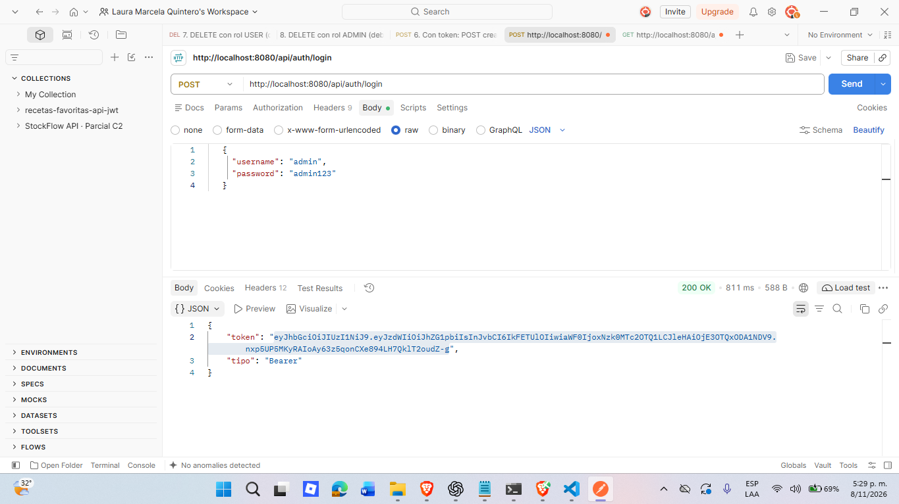
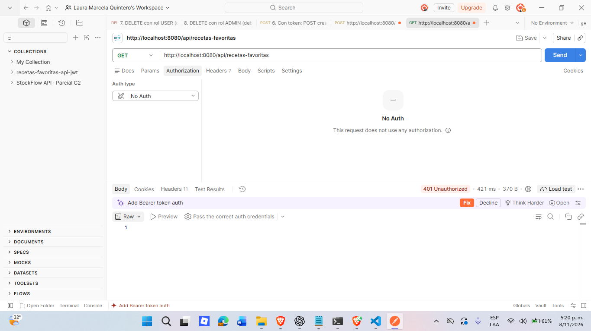
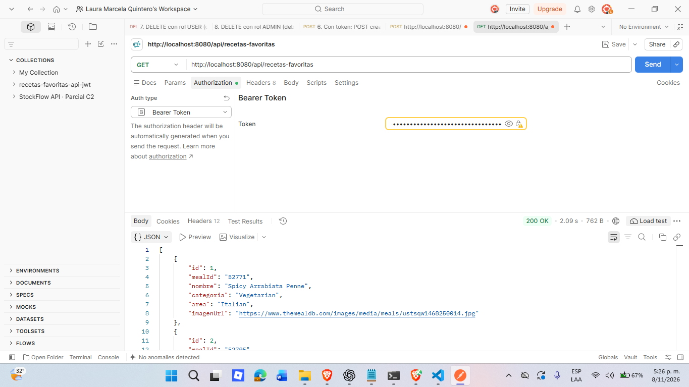
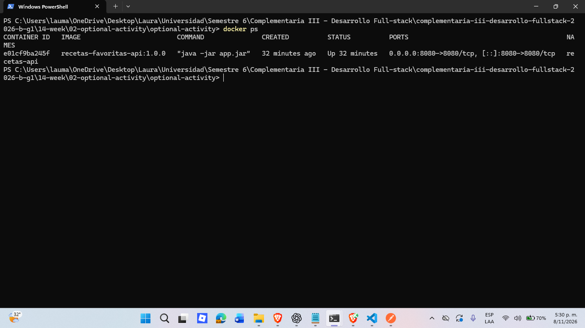
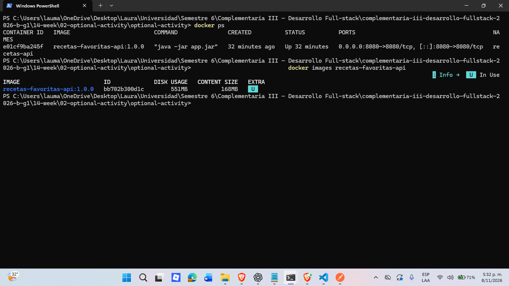

# Semana 14 · Contenedores con Docker — Recetas Favoritas

| | |
|---|---|
| **Estudiante** | Laura Marcela |
| **Materia** | Complementaria III - Profundización Desarrollo Fullstack (2026-B) |
| **Usuario de GitHub** | laura-marcela05 |

Hasta la semana pasada mi API de recetas favoritas solo corría en mi computador, con Java y Maven instalados. Esta semana
la empaqueté con Docker: ahora la API corre dentro de un contenedor y se comporta igual en cualquier máquina que tenga
Docker. Escribí un Dockerfile, construí la imagen, corrí el contenedor y comprobé con Postman que responde desde ahí.

## 1. Estructura del proyecto

```
optional-activity/
├── README.md
├── evidencias/                      (capturas: 01-11 de la semana 13, 12-16 de Docker)
├── recetas-favoritas-api/           (backend)
│   ├── Dockerfile                   (nuevo: la receta de la imagen)
│   ├── .dockerignore                (nuevo: qué no entra al contexto de build)
│   ├── pom.xml
│   └── src/
└── recetas-favoritas-front/         (frontend, no se contenerizó esta semana)
```

No cambié el código de la aplicación. Solo agregué el `Dockerfile` y el `.dockerignore`.

## 2. Conceptos

- **Imagen:** la plantilla congelada. Tiene mi API y el Java que necesita.
- **Contenedor:** una instancia de esa imagen corriendo. De una misma imagen puedo correr varios contenedores.
- **Dockerfile:** el archivo con la receta para construir la imagen.

```
Dockerfile  --docker build-->  Imagen  --docker run-->  Contenedor
```

## 3. El Dockerfile

```dockerfile
FROM eclipse-temurin:17-jre
WORKDIR /app
COPY target/recetas-favoritas-api-1.0.0.jar app.jar
EXPOSE 8080
ENTRYPOINT ["java", "-jar", "app.jar"]
```

- `FROM eclipse-temurin:17-jre`: imagen base con solo el JRE de Java 17, el mismo Java que declara el `pom.xml`.
  Usé `jre` y no `jdk` porque para ejecutar el jar no necesito compilar.
- `WORKDIR /app`: carpeta de trabajo dentro del contenedor.
- `COPY ...`: copia el jar que genera Maven. Se llama `artifactId-version`, o sea `recetas-favoritas-api-1.0.0.jar`.
  Si cambio la `version` del `pom.xml`, hay que cambiarla aquí también.
- `EXPOSE 8080`: solo documenta el puerto. No lo abre hacia mi PC; eso lo hace `-p` en `docker run`.
- `ENTRYPOINT`: el comando que se ejecuta cuando arranca el contenedor.

**Por qué el jar se construye fuera de Docker:** compilo con `mvn clean package` en mi máquina y el Dockerfile solo lo
copia. Es lo más simple y cumple lo que pide la actividad. La otra opción (multi-stage) compila dentro de Docker y no
depende de tener Maven instalado, pero es más larga y más lenta.

## 4. Cómo construir y correr (PowerShell)

Requisitos: Docker Desktop encendido, Java 17 o superior y Maven. Todos los comandos se ejecutan desde la carpeta
`recetas-favoritas-api`.

**1. Generar el jar** (también corre las 13 pruebas de la semana 13):

```powershell
mvn clean package
```

**2. Construir la imagen:**

```powershell
docker build -t recetas-favoritas-api:1.0.0 .
```

**3. Correr el contenedor** (el puerto 8080 de mi PC apunta al 8080 del contenedor):

```powershell
docker run -d --name recetas-api -p 8080:8080 -e JWT_SECRET="clave-de-ejemplo-para-docker-minimo-32-caracteres" recetas-favoritas-api:1.0.0
```

**4. Comprobar que está corriendo:**

```powershell
docker ps
docker logs recetas-api --tail 15
```

En los logs debe aparecer `Started RecetasFavoritasApplication`. Tarda unos 20 segundos en arrancar.

**5. Detenerlo y borrarlo** (necesario antes de volver a crear uno con el mismo nombre):

```powershell
docker stop recetas-api
docker rm recetas-api
```

## 5. Puertos y variables de entorno

| Qué | Valor |
|---|---|
| Puerto de la API en el contenedor | 8080 |
| Puerto publicado en mi PC | 8080 (`-p 8080:8080`) |
| `JWT_SECRET` | Clave con la que la API firma y valida los tokens (mínimo 32 caracteres) |

La clave se pasa con `-e JWT_SECRET=...`. El `application.properties` la lee con `${JWT_SECRET:valor-por-defecto}`. La
que uso en este README es solo un ejemplo: en un proyecto real nunca va una clave verdadera en el repositorio.

## 6. Qué se pierde al reiniciar

La base de datos es **H2 en memoria**, y `ddl-auto` está en `create-drop`. Eso significa que los datos viven solo mientras
el contenedor corre. Si lo detengo o lo borro, las recetas que guardé desaparecen. Al arrancar de nuevo, la clase
`DataInitializer` vuelve a crear los usuarios de prueba (`admin` y `user`) y 2 recetas.

Para conservar datos haría falta una base de datos real, por ejemplo en otro contenedor, o un volumen. Esta actividad no
lo pedía.

## 7. Verificación

Probé la API **dentro del contenedor** con Postman, contra `http://localhost:8080`:

| Prueba | Petición | Resultado esperado |
|---|---|---|
| Login | `POST /api/auth/login` con `admin` / `admin123` | 200 y un token |
| Sin token | `GET /api/recetas-favoritas` sin Authorization | 401 |
| Con token | `GET /api/recetas-favoritas` con `Bearer <token>` | 200 y la lista de recetas |

1. **Login 200:**

   

2. **Sin token, 401:**

   

3. **Con token, 200:**

   

4. **Contenedor corriendo (`docker ps`):**

   

5. **Imagen construida (`docker images`):**

   

Son los mismos códigos que cuando la API corría en mi máquina, así que la app empaquetada se comporta igual.

## 8. Pruebas de la semana 13

El proyecto sigue trayendo las pruebas automáticas de la semana pasada:

```powershell
# Backend, desde recetas-favoritas-api (13 pruebas)
mvn test

# Frontend, desde recetas-favoritas-front (3 pruebas)
npm install
npm test
```

`mvn clean package` corre las del backend antes de empaquetar el jar, así que si una prueba falla, no se genera el jar.

## 9. Errores que me pueden pasar

- **`port is already allocated`:** algo más está usando el 8080 (por ejemplo `mvn spring-boot:run`). Lo cierro y repito.
- **`container name is already in use`:** ya existe un contenedor `recetas-api`. Lo borro con `docker rm recetas-api`.
- **`COPY failed: file not found`:** falta el jar. Hay que correr `mvn clean package` antes del `docker build`.
- **El contenedor se cae al arrancar:** veo la causa con `docker logs recetas-api`.
- **El frontend no puede llamar a la API:** el CORS solo permite `http://localhost:5173`. El frontend no está en un contenedor.